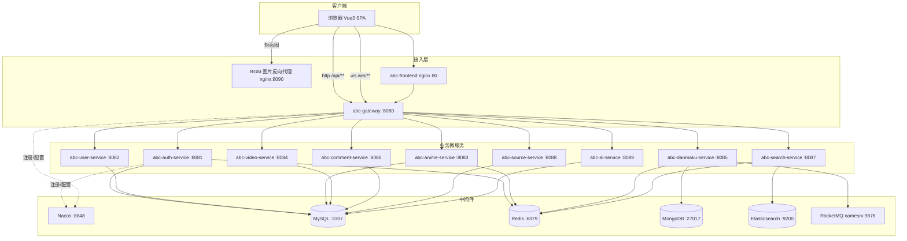
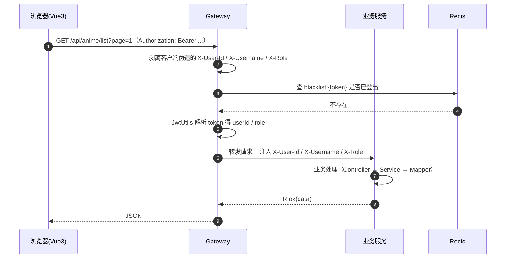
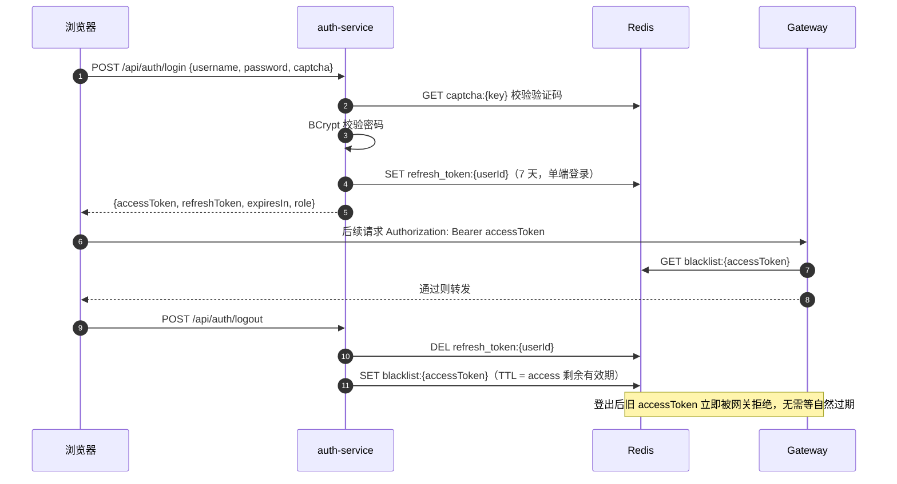
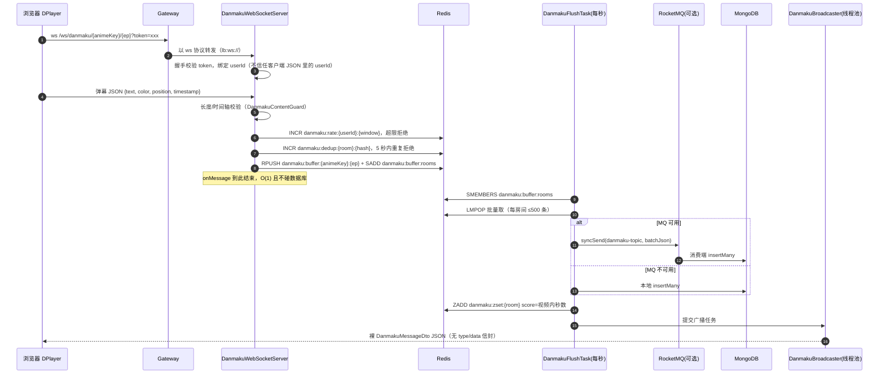
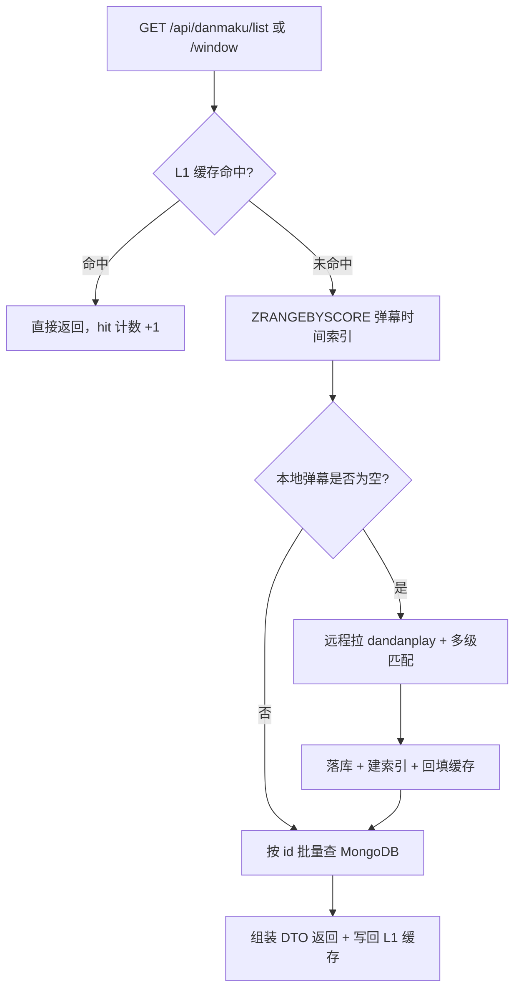
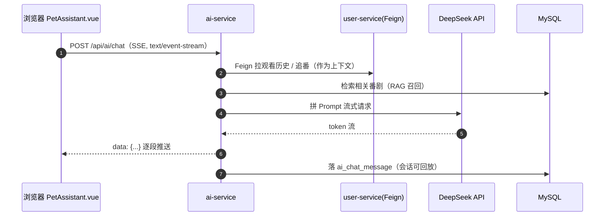
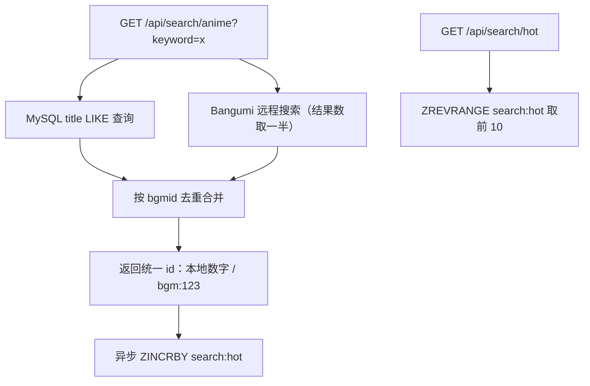

# 系统架构图与关键链路说明

> 适用对象：论文第 4 章（系统设计）与答辩讲解。图中每个节点都给出对应源码位置，便于现场打开 IDE 逐点讲解。
> 基线：`abc-*` 12 个 Maven 模块 + `abc-frontend`（Vue3），10 个业务微服务，Nacos 注册与配置，Spring Cloud Gateway 统一入口。

## 0. 一眼看懂：系统分几层

```
┌──────────────────────────────────────────────────────────────┐
│ 表现层      Vue3 + TypeScript + Pinia + Element Plus + DPlayer │
│             浏览器 3000（开发）/ abc-frontend 容器 80          │
├──────────────────────────────────────────────────────────────┤
│ 接入层      abc-gateway :8080  Spring Cloud Gateway            │
│             路由转发 + JWT 校验 + 身份头注入 + 黑名单拦截       │
├──────────────────────────────────────────────────────────────┤
│ 业务层      auth:8081  user:8082  anime:8083  video:8084       │
│             danmaku:8085  comment:8086  search:8087            │
│             source:8088  ai:8089                               │
├──────────────────────────────────────────────────────────────┤
│ 公共层      abc-common（R 统一返回 / JwtUtils / 异常 / 常量）    │
├──────────────────────────────────────────────────────────────┤
│ 中间件      MySQL8  Redis5  MongoDB5  Elasticsearch7.17        │
│             RocketMQ 5.1（可选启用）  Nacos 2.3.1              │
└──────────────────────────────────────────────────────────────┘
```

## 1. 部署拓扑（docker compose 一键起 20 个服务定义）



关键事实（可现场验证）：

- 网关端口 `8080` 定义在 `abc-gateway/src/main/resources/application.yml:67-68`；
- MySQL 宿主端口是 **3307**（避开本机可能已装的 3306），见 `docker-compose.yml:63-64`；
- 图片走 `abc-bgm-gateway`（nginx）反向代理，绕开 Bangumi 图床的 Referer 限制，见 `docker-compose.yml:267-272`；
- `abc-frontend` 容器内是 nginx，宿主 3000 映射容器 80，见 `docker-compose.yml:583-595`；
- 网关另有一条 `lb:ws://abc-danmaku-service` 的 WebSocket 路由（`Path=/ws/**`），见 `application.yml:46-50`。

## 2. 服务职责与端口对照表

| 服务 | 端口 | 核心职责 | 关键实现类 | 数据依赖 |
| --- | --- | --- | --- | --- |
| abc-gateway | 8080 | 统一入口、路由、JWT 校验、身份头注入、黑名单 | `JwtAuthGlobalFilter` | Redis, Nacos |
| abc-auth-service | 8081 | 注册、登录、刷新、登出、图形验证码 | `AuthServiceImpl` | MySQL, Redis |
| abc-user-service | 8082 | 资料、关注、历史、收藏、进度、搜索历史、AI 配置 | `UserController`, 收藏/进度服务 | MySQL |
| abc-anime-service | 8083 | 番剧列表/详情/剧集/日历/标签、Bangumi 同步与镜像 | `AnimeController`, `BangumiDataSource`, `BangumiMirrorController` | MySQL, Redis |
| abc-video-service | 8084 | 视频元数据与播放地址 | `VideoController` | MySQL |
| abc-danmaku-service | 8085 | 弹幕收发（WebSocket）、远程拉取、时间窗查询、热度 | `DanmakuWebSocketServer`, `DanmakuFlushTask`, `DanmakuQueryService` | MongoDB, Redis, RocketMQ |
| abc-comment-service | 8086 | 评论、评分、Bangumi 评论聚合 | `CommentService`, `CommentController` | MySQL |
| abc-search-service | 8087 | ES 全文检索、索引重建（可切换网关搜索实现） | `AnimeSearchService` | Elasticsearch, Redis |
| abc-source-service | 8088 | 规则化视频源引擎、在线调试、播放解析、流代理 | `SourceRule` 相关类, `ProxyController` | MySQL |
| abc-ai-service | 8089 | AI 桌宠对话（SSE 流式）、RAG 检索 | `ChatController`, RAG 服务 | MySQL |
| abc-common | — | 统一返回 `R`、`JwtUtils`、全局异常、常量 | `R.java`, `JwtUtils` | — |

> 搜索能力目前有两套：网关默认把 `/api/search/**` 路由到 `abc-anime-service`（MySQL + Bangumi 远程聚合），`abc-search-service` 是 Elasticsearch 版本，通过改路由可切换。见 `abc-gateway/src/main/resources/application.yml:31-35`。

## 3. 一次正常请求：前端 → 网关 → 服务



- 过滤器位置：`abc-gateway/src/main/java/com/abc/gateway/filter/JwtAuthGlobalFilter.java`，`getOrder()` 返回 -100（`:217-219`），先于 Spring 内置过滤器执行；
- 四个身份头常量在 `:46-50`；公开白名单 `PUBLIC_ALL`（`:55-64`）与匿名可读 `ANONYMOUS_GET`（`:70-84`）分离，登录接口与番剧浏览的鉴权策略不同；
- 无条件先删客户端传入的身份头（`:106-111`），防止「伪造 X-User-Id 冒充他人」——答辩可讲的第一个安全点；
- 管理接口 `/api/datasource/**`、`/api/admin/**` 强制 ADMIN 角色（`:87-90`、`:152`）。

## 4. 鉴权链路：双 Token + 单端登录 + 登出即失效



代码位置：`abc-auth-service/src/main/java/com/abc/auth/service/impl/AuthServiceImpl.java`

- 登录成功后写 `refresh_token:{userId}`（`:121-122`），带 TTL 实现「同一账号后登录踢掉先登录」；
- 登出时删 refresh 并把 access 加入 `blacklist:{token}`（`:147-153`）；
- 网关侧黑名单查询用 `Mono.fromCallable(...).subscribeOn(boundedElastic)`（`JwtAuthGlobalFilter.java:180-187`），Redis 故障时 `onErrorResume` 降级放行，可用性优先；
- 验证码存 `captcha:{key}`（`AuthServiceImpl.java:217/232`），一次性消费。
## 5. 弹幕链路（本系统技术含量最高的部分）

### 5.1 写路径：onMessage 只做三件事，落库与广播异步化



设计取舍（答辩必讲）：

| 决策 | 方案 | 理由 | 位置 |
| --- | --- | --- | --- |
| 削峰 | Redis List 缓冲 + 每秒批量 LMPOP | Mongo 单条写放大严重；flush 用 `fixedDelay` 防止线程叠加 | `service/DanmakuBufferService.java`, `service/DanmakuFlushTask.java` |
| 解耦 | RocketMQ 可选开关 | `ObjectProvider<RocketMQTemplate>` + `danmaku.mq.enabled`，没起 MQ 也能跑，起 MQ 走异步 | `mq/DanmakuMessageProducer.java` |
| 顺序 | 先落库 → ZSET → 缓存失效 → 广播 | 广播是尽力而为，历史查询必须查得到；落库失败就不该广播 | `service/DanmakuDispatchService.java` |
| 幂等/重投 | 消费端异常抛出让 Broker 重投，批量写天然幂等 | 弹幕重复一次不致命，可用性优先于严格一次 | `mq/DanmakuMessageConsumer.java` |
| 反压 | 积压超 `warn-size` 打 WARN；广播走独立线程池 | 高峰宁可慢也不能阻塞 WS IO 线程 | `config/DanmakuProperties.java` 的 Buffer/Mq 段 |

### 5.2 读路径：L1 缓存 + ZSET 时间窗 + 懒加载远程弹幕



- 接口：`GET /api/danmaku/list`、`/window`、`/heat`，见 `abc-danmaku-service/src/main/java/com/abc/danmakuservice/controller/DanmakuController.java:39-79`；
- 自研 L1 缓存 `cache/DanmakuLocalCache.java`（`LinkedHashMap(accessOrder=true)` + TTL + 命中率统计），刻意不用 Caffeine：项目要求离线 Maven 构建；
- 远程匹配逐级降级：精确标题 → 主标题模糊 → 集数对齐，见 `source/dandanplay/DanmakuEpisodeMatcher.java` 与 `DanmakuMatchMethod.java`。

## 6. 规则化视频源引擎（source-service）

```mermaid
flowchart LR
    A[source_rule 表<br/>搜索URL / 列表选择器 / 播放选择器] --> B[规则校验 + 在线测试<br/>POST /api/source/test]
    B --> C[关键词替换 @keyword<br/>Jsoup 解析 CSS/XPath]
    C --> D[搜索得到剧集列表]
    D --> E[选集 + 解析播放直链 m3u8/mp4]
    E --> F{直链被防盗链?}
    F -- 是 --> G[/api/source/proxy<br/>服务端补 Referer 流式转发]
    F -- 否 --> H[前端 DPlayer 直接播放]
```

- 规则表结构见 `sql/source_rule.sql`，字段含搜索 URL、列表/选集/播放选择器、请求头等；
- 与 Animeko / Kazumi 的规则格式做了导入兼容，答辩时可用现成规则演示「换源」；
- 流代理 `/api/source/proxy` 解决了浏览器直连第三方 CDN 被 Referer 拦截的问题。

## 7. AI 桌宠对话链路（SSE 流式 + RAG）



- 用到 LangChain4j 1.0.0 + DeepSeek（OpenAI 兼容协议），表 `ai_chat_session` / `ai_chat_message` 见 `sql/ai_chat.sql`；
- 流式返回是 SSE 而不是 WebSocket：单向推送用 SSE 更简单，还能复用 HTTP 鉴权头；
- 用户 API Key 加密存在用户服务（`/api/user/ai-key`），AI 服务通过 Feign 取用，避免明文落前端。

## 8. 搜索与热搜链路



- 本地 + 远程聚合：先查库保证速度与可控性，再补远程保证召回，见 `abc-anime-service/src/main/java/com/abc/animeservice/controller/SearchController.java:29-72`；
- 热搜是 Redis ZSet 计数（`search:hot`，`:94`、`:149`），无额外表；
- Elasticsearch 版本在 `abc-search-service`：索引 `abc_anime`，`title^3 + tags^2 + description` 加权（论文里可做「MySQL LIKE vs ES」的对比实验）。

## 9. 数据存储分布

| 存储 | 内容 | 说明 |
| --- | --- | --- |
| MySQL | `user` `anime` `episode` `tag` `anime_tag` `comment` `rating` `user_follow` `watch_history` `video`（`sql/abc_anime.sql`）；`user_favorite` `search_history` `user_progress` `danmaku_report`（`sql/03_platform_extension.sql`）；`ai_chat_session` `ai_chat_message`（`sql/ai_chat.sql`）；`source_rule`（`sql/source_rule.sql`） | 强事务/关系型数据 |
| MongoDB | 弹幕集合（animeKey + episodeNum 维度） | 高写入、结构松散、按集查询 |
| Elasticsearch | 索引 `abc_anime` | 全文检索与加权排序 |
| Redis | 见下表 | 缓存/计数/缓冲/索引 |

Redis 键清单（`abc-danmaku-service/src/main/java/com/abc/danmakuservice/util/DanmakuKeys.java` 集中定义，`:12-23`）：

| 键模式 | 类型 | 用途 |
| --- | --- | --- |
| `danmaku:buffer:{animeKey}:{ep}` | List | 待落库弹幕缓冲 |
| `danmaku:buffer:rooms` | Set | 有积压的房间注册表（避免 KEYS 扫描） |
| `danmaku:zset:{animeKey}:{ep}` | ZSet | 弹幕时间索引，score=视频内秒数 |
| `danmaku:rate:{userId}:{window}` | String | 发送频率限制计数器 |
| `danmaku:dedup:{animeKey}:{ep}:{hash}` | String | 5 秒去重窗口 |
| `blacklist:{token}` / `refresh_token:{userId}` / `captcha:{key}` | String | 登出黑名单 / 单端登录 / 验证码 |
| `search:hot` | ZSet | 搜索热词榜 |
| `anime:hot:{limit}` / `anime:views` | String / ZSet | 热门列表缓存 / 播放量计数 |
| `anime:episodes:{bgmId}` | String | 剧集列表缓存 |

## 10. 关键设计取舍速查

| 设计点 | 本系统选择 | 替代方案及不选原因 |
| --- | --- | --- |
| 服务拆分 | 按业务域拆 10 个服务 | 不按技术分层拆（避免「Controller 服务」这种伪微服务） |
| 网关鉴权 | Gateway 全局过滤器统一校验 | 每个服务各写一套拦截器：重复且易漏，早期版本就是这么做的 |
| 弹幕存储 | MongoDB | MySQL：弹幕量大、按集查、无需事务 |
| 弹幕写 | Redis 缓冲 + 批量落库（可选 MQ） | 直接写库：WS 线程被 DB 阻塞，压测会看到 P95 飙升 |
| 搜索 | MySQL 聚合 + ES 可选 | 只用 ES：要维护索引一致性；只用 LIKE：无相关性排序 |
| 番剧数据 | Bangumi 官方 API + 本地镜像 | 自建爬虫：合规风险与维护成本高 |
| 视频源 | 规则引擎（选择器可配置） | 硬编码某个站点：站点一改版就废 |
| 前端播放器 | DPlayer | 自研播放器：与毕设目标无关 |

## 11. 与论文的对应关系

| 论文章节 | 可直接引用的图 |
| --- | --- |
| 4.1 总体架构 | 本文 §0 分层图、§1 部署拓扑 |
| 4.2 微服务拆分 | §2 服务职责表 |
| 4.3 鉴权与安全 | §3、§4 两张时序图 |
| 4.4 弹幕子系统 | §5 两张图 |
| 4.5 视频源引擎 | §6 |
| 4.6 AI 桌宠 | §7 |
| 4.7 搜索 | §8 |
| 4.8 数据库设计 | §9 三张表（存储分布 + Redis 键） |
| 第 5 章 测试 | `docs/实验报告-*.md` 与 `jmeter/README.md` |

> 图使用 mermaid 语法，Typora / VS Code（Markdown Preview Mermaid Support）/ GitHub 均可直接渲染；导出 PDF 前建议先在 Typora 里检查一遍换行。
